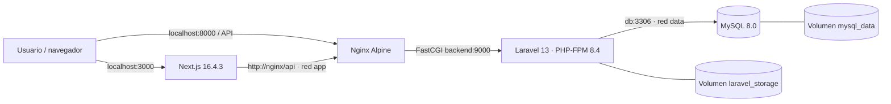

# PCForge Docker — Next.js, Nginx, Laravel y MySQL

**Actividad evaluada:** Ingeniería de Imágenes Eficientes: Refactorización Multi-stage y Optimización de Capas en Docker.

PCForge es un e-commerce de componentes para computadoras. Este repositorio contiene el **frontend Next.js 16.4.3**, la **API Laravel 13**, su proxy **Nginx** y una base **MySQL 8.0**, orquestados con Docker Compose. La infraestructura se preparó a partir de aplicaciones desarrolladas previamente.

> **Alcance:** despliegue reproducible para demostración académica en Docker Desktop (contenedores Linux). No se considera un despliegue de Internet pública endurecido; requeriría TLS, gestión de secretos, copias de seguridad y monitoreo.

## Arquitectura



| Servicio Compose | Base de imagen | Responsabilidad | Publicación de puertos |
| --- | --- | --- | --- |
| `frontend` | `node:22-alpine` | Construcción multi-stage y ejecución Next.js mediante `next start` | `3000:3000` |
| `nginx` | `nginx:stable-alpine` | HTTP para Laravel; envía PHP a PHP-FPM por FastCGI | `8000:80` |
| `backend` | `php:8.4-fpm-alpine` | API Laravel, JWT, órdenes, migraciones y seeder inicial | Solo `9000` interno |
| `db` | `mysql:8.0` | Datos persistentes de productos, usuarios y órdenes | Solo `3306` interno |

Las redes son `app` (frontend, Nginx y backend) y `data` (backend y MySQL), esta última con `internal: true`. MySQL **no** publica su puerto al host. Los healthchecks y `depends_on: condition: service_healthy` coordinan el inicio de los servicios.

## Estructura del repositorio

```text
pcforge-docker/
├── frontend/
│   ├── Dockerfile
│   ├── .dockerignore
│   ├── pnpm-workspace.yaml
│   ├── package.json
│   ├── pnpm-lock.yaml
│   ├── src/
│   └── public/
├── backend/
│   ├── Dockerfile
│   ├── .dockerignore
│   ├── composer.json
│   ├── composer.lock
│   ├── app/
│   ├── database/
│   ├── public/
│   └── docker/
│       ├── entrypoint.sh
│       └── seed-if-empty.php
├── docker/
│   ├── nginx/
│   │   ├── Dockerfile
│   │   └── default.conf
│   ├── mysql/
│   │   └── Dockerfile
│   └── scripts/
│       └── Initialize-Env.ps1
├── evidencias/
├── docker-compose.yml
├── .env.example
├── .dockerignore
├── .gitignore
└── README.md
```

## Requisitos

- Docker Desktop ejecutándose en modo **Linux containers**, con Docker Compose.
- Puertos `3000` y `8000` libres en el equipo anfitrión.
- Para crear el `.env` automáticamente en Windows: PowerShell 5.1 o superior.
- Internet para descargar imágenes y dependencias durante el primer build.

No se requiere instalar PHP, Composer, Node.js, MySQL ni Nginx directamente en el host para ejecutar el ecosistema.

## Inicio rápido: un solo comando para el ecosistema

Desde la raíz del repositorio, generar primero el archivo local de configuración si no existe:

```powershell
powershell.exe -NoProfile -ExecutionPolicy Bypass -File .\docker\scripts\Initialize-Env.ps1
```

Este script genera `.env` con `APP_KEY`, `JWT_SECRET` y contraseñas MySQL distintas a las de otros entornos. **No imprime los secretos ni sobrescribe un `.env` existente.** El archivo `.env.example` documenta las variables requeridas, pero contiene marcadores de posición.

Validar la configuración y construir/arrancar todos los servicios:

```powershell
docker compose config --quiet
docker compose up --build -d
```

Verificar el resultado:

```powershell
docker compose ps
docker compose logs --tail=50 backend nginx
```

Los cuatro servicios deben aparecer activos y saludables. Si se prefiere ver los registros en primer plano, también se puede utilizar `docker compose up --build` (sin `-d`).

### Direcciones locales

- **Tienda:** http://localhost:3000/products
- **API de productos (Nginx → Laravel):** http://localhost:8000/api/products
- **Documentación Swagger:** http://localhost:8000/api/documentation, si las dependencias de documentación están presentes en el build de producción.

> Dentro de Docker, `localhost` hace referencia al contenedor propio, no al host. Por ello, el frontend utiliza `API_BASE_URL=http://nginx/api` en la red interna de Compose. La URL `http://localhost:8000` es para acceder a la API desde el navegador del host.

## Configuración de entorno

La plantilla `.env.example` describe estas variables:

| Variable | Uso |
| --- | --- |
| `APP_KEY` | Clave de Laravel; debe ser privada |
| `JWT_SECRET` | Firma de tokens JWT; debe ser privada |
| `MYSQL_ROOT_PASSWORD` | Contraseña del usuario root de MySQL |
| `MYSQL_DATABASE` | Base de datos inicial (`pcforge`) |
| `MYSQL_USER` | Usuario de aplicación (`pcforge`) |
| `MYSQL_PASSWORD` | Contraseña del usuario de aplicación |
| `FRONTEND_PORT` | Puerto HTTP del frontend (predeterminado `3000`) |
| `API_PORT` | Puerto HTTP de Nginx (predeterminado `8000`) |
| `STRIPE_SECRET` | Opcional, exclusivamente clave de sandbox `sk_test_` para pagos de prueba |
| `STRIPE_WEBHOOK_SECRET` | Opcional, firma `whsec_` del listener de prueba |

**Nunca subir `.env` ni credenciales reales a GitHub.** El archivo `.env.example` sí se publica.

## Dockerfiles multi-stage y decisiones técnicas

### Frontend: `frontend/Dockerfile`

- `base`: fija `node:22-alpine` y `pnpm@12.11.2`.
- `dependencies`: instala dependencias con `pnpm install --frozen-lockfile` y caché BuildKit compartida.
- `production-dependencies`: instala únicamente dependencias de ejecución.
- `build`: realiza `pnpm build` con los archivos fuente.
- `runtime`: copia `node_modules` de producción y los artefactos `.next`, `public` y configuración necesarios; ejecuta Next.js en el puerto `3000` como usuario `node`, sin reinstalar herramientas de desarrollo.

Se eligió **Node 22 Alpine** en vez de Node 20 porque esta aplicación fija **pnpm 12.11.2**. La configuración de `pnpm-workspace.yaml` autoriza específicamente el script de `unrs-resolver` y mantiene bloqueados los scripts no necesarios, conservando la política reproducible de pnpm.

La copia de `package.json`, `pnpm-lock.yaml` y `pnpm-workspace.yaml` **antes** del código fuente permite reutilizar la capa de instalación cuando se modifica la aplicación sin cambiar dependencias.

### Backend: `backend/Dockerfile`

- `php-base`: usa `php:8.4-fpm-alpine` y compila las extensiones PHP necesarias, eliminando los paquetes de compilación posteriormente.
- `composer-build`: instala `vendor/` a partir de `composer.lock` con `composer install --no-dev`, sin resolver nuevas versiones.
- `runtime`: copia el código fuente y desde la etapa anterior solo las dependencias `vendor/` y los artefactos de bootstrap requeridos; **Composer no se instala en runtime**.

Se eligió **PHP 8.4** porque las versiones de Symfony bloqueadas en `composer.lock` requieren PHP 8.4.1 o superior. Usar PHP 8.3 impedía compilar, mientras que actualizar el runtime permitió conservar el lockfile sin usar `--ignore-platform-reqs`.

PHP-FPM ejecuta como `www-data`, atiende en el puerto interno `9000` y recibe la configuración mediante variables de entorno.

### Nginx y MySQL

- `docker/nginx/Dockerfile` usa una base Alpine y copia únicamente la configuración Nginx y `backend/public/`; dirige las peticiones PHP al backend por FastCGI.
- `docker/mysql/Dockerfile` utiliza la **imagen oficial `mysql:8.0`**, exigida expresamente por la actividad. Es la excepción a Alpine porque no se sustituye la imagen oficial requerida.
- `.dockerignore` en la raíz y en las aplicaciones excluye `node_modules`, `.next`, `vendor`, secretos, cachés y archivos innecesarios para reducir los contextos de build y evitar invalidar capas sin necesidad.

## Inicialización automática de MySQL y Laravel

Al iniciar el stack:

1. MySQL prepara la base `pcforge` y espera a superar su healthcheck.
2. Laravel aplica las migraciones pendientes con `php artisan migrate --force`.
3. Si `products` está vacío, se ejecuta **solo** `ProductSeeder` para cargar los 20 artículos iniciales.
4. PHP-FPM comienza a atender peticiones.
5. Nginx y Next.js se ponen en servicio cuando sus dependencias se encuentran saludables.

`DatabaseSeeder` no se ejecuta en este proceso porque crea una cuenta académica con credenciales conocidas. Los productos no se duplican ni se restablece el stock durante los reinicios normales.

## Pruebas de funcionamiento

```powershell
# Cuatro servicios saludables
docker compose ps

# API a través de Nginx
curl.exe -i http://localhost:8000/api/products

# Catálogo renderizado por Next.js
curl.exe -i http://localhost:3000/products

# Migraciones Laravel
docker compose exec -T backend php artisan migrate:status
```

**Resultados observados durante el desarrollo:** cuatro contenedores saludables; API HTTP 200 con 20 productos (8 en la primera página); catálogo HTTP 200 y renderizado; siete migraciones ejecutadas. También se comprobó mediante el navegador el funcionamiento de registro, sesión, carrito y órdenes en el entorno Docker.

## Persistencia de datos

Los datos de MySQL permanecen en el volumen con nombre `mysql_data` (volumen de Compose); los archivos persistentes de Laravel usan `laravel_storage`. Se comprobó la conservación de datos al recrear los contenedores sin eliminar volúmenes.

Apagar y levantar sin borrar datos:

```powershell
docker compose down
docker compose up -d --no-build --wait
```

**No ejecutar** `docker compose down -v` ni `docker volume prune` si se desean conservar los registros del entorno.

## Evidencias de la actividad

La carpeta `evidencias/` incluye los registros y/o capturas obtenidos durante las pruebas:

- `docker compose ps`: cuatro servicios saludables.
- Catálogo de Next.js y respuesta de `/api/products`.
- Estado de las siete migraciones.
- `docker image ls` y `docker history`: tamaños y capas de imágenes.
- Segundo build con instrucciones `CACHED`: reutilización de caché.
- Persistencia MySQL tras recrear los contenedores.
- Prueba funcional de usuarios y órdenes.

Ejemplos para reproducir estas comprobaciones:

```powershell
docker image ls
docker history pcforge-frontend:local
docker history pcforge-backend:local
docker compose --progress plain build frontend backend
```

Las capturas de terminal y logs son evidencia de ejecución; **no deben contener contraseñas, claves API, JWT ni información personal de usuarios reales**. Los tamaños concretos de imágenes se documentan mediante los resultados medidos, sin inventar porcentajes de reducción.

## Stripe en el entorno Docker (opcional)

El flujo de compra puede crear órdenes sin configurar Stripe, y esa prueba valida las mutaciones y la persistencia. Para probar un pago en sandbox, configurar `STRIPE_SECRET=sk_test_...` y `STRIPE_WEBHOOK_SECRET=whsec_...` **solo en el `.env` privado de Docker**, y ejecutar Stripe CLI contra:

```powershell
stripe listen --forward-to http://127.0.0.1:8000/api/stripe/webhook
```

Stripe CLI y la clave de Laravel deben usar el mismo sandbox. No se requieren pagos adicionales para evidenciar el criterio de orquestación de esta actividad.

## Código y alcance

El repositorio incluye **ambas aplicaciones** (`frontend/` y `backend/`) y la infraestructura completa, tal como solicita la rúbrica. No depende de descargar el código desde otro repositorio para poder construirse.

La arquitectura está optimizada para desarrollo reproducible y evaluación local. Para una instalación pública real se necesitarían, además, TLS, un balanceador/reverse proxy de Internet, políticas de secretos, backups y controles operacionales.
